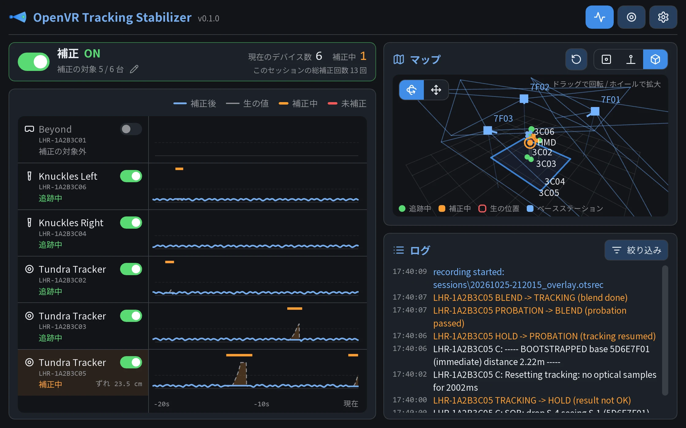
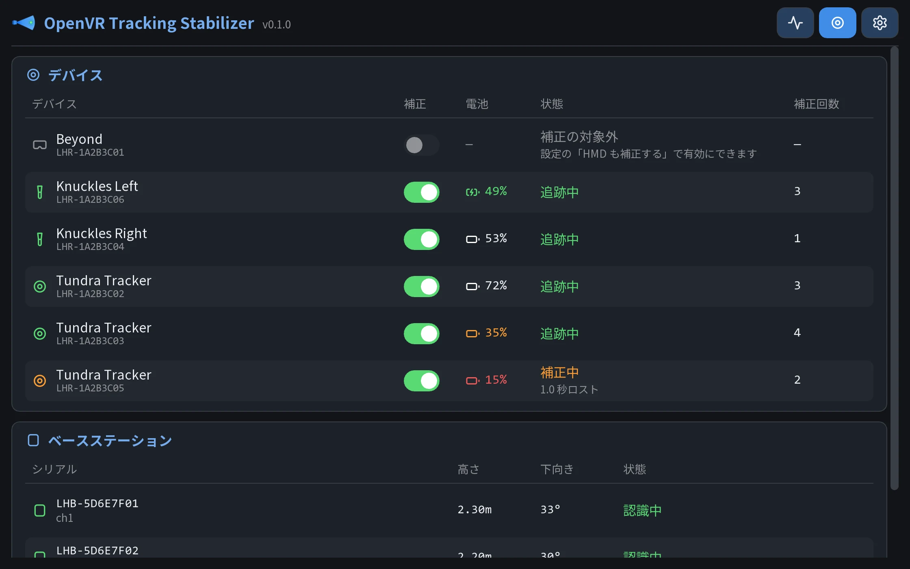
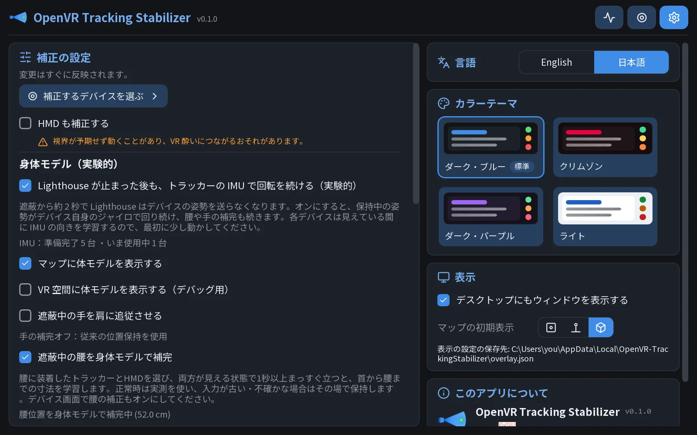

# OpenVR-TrackingStabilizer

Lighthouse 系のトラッカーやコントローラーが布やオブジェクトに隠れていても、飛びにくくする SteamVR ツールです。

通常、Lighthouse 系のトラッカーはベースステーションから見えなくなると飛びやすく、約 2 秒でロストします。
このツールを使うと、トラッキングが飛んでもその場に留まります。

なお、このアプリは Vibe Coded です。

## プレビュー



| デバイス | 設定 |
| --- | --- |
|  |  |

画面はサンプルデータで表示しています。

## できること

- トラッキングが飛んだトラッカーとコントローラーを、その場に静止させる
- トラッキングが戻ったら、実際の位置へなめらかに戻す
- SteamVR のダッシュボードとデスクトップのウィンドウで、状態の確認と設定の変更をする

次の機能は実験的機能で、既定ではオフです。

- 隠れている手を、頭の動きに合わせて動かす
- 隠れている腰を、頭の動きに合わせて動かす
- Lighthouse が位置を送らなくなったあとも、トラッカーの IMU で回転を続ける

## 必要なもの

- Windows 10 / 11（64 ビット）
- SteamVR
- Lighthouse 対応のトラッカーまたはコントローラー

## 使い方

1. [Releases](https://github.com/KRHa0024/OpenVR-TrackingStabilizer/releases) から zip をダウンロードして展開する
2. SteamVR を終了し、`Setup.cmd` をダブルクリックして `[1]` を選ぶ
3. SteamVR を起動し、ダッシュボードの「Tracking Stabilizer」を開く

管理者権限は不要です。更新するときも同じ手順です。アンインストールするときは `[2]` を選びます。

## 制限

- 足や膝の位置は推定しません。隠れた場合は、その場に留まるだけです
- Lighthouse 以外のデバイスは補正しません
- SteamVR の内部の処理に割り込んで動作するため、SteamVR の更新で動かなくなることがあります

動作がおかしいときは、SteamVR の設定 → スタートアップ/シャットダウン → アドオンの管理で `trackingstabilizer` をオフにしてください。

## ビルド

Visual Studio 2022（C++ ワークロード）が必要です。

```powershell
git submodule update --init --recursive --depth 1
cmake -S . -B build -G "Visual Studio 17 2022" -A x64
cmake --build build --config Release
```

開発者向けの情報は [docs/development.md](docs/development.md) にあります。

## ライセンス

[MIT License](LICENSE) です。
